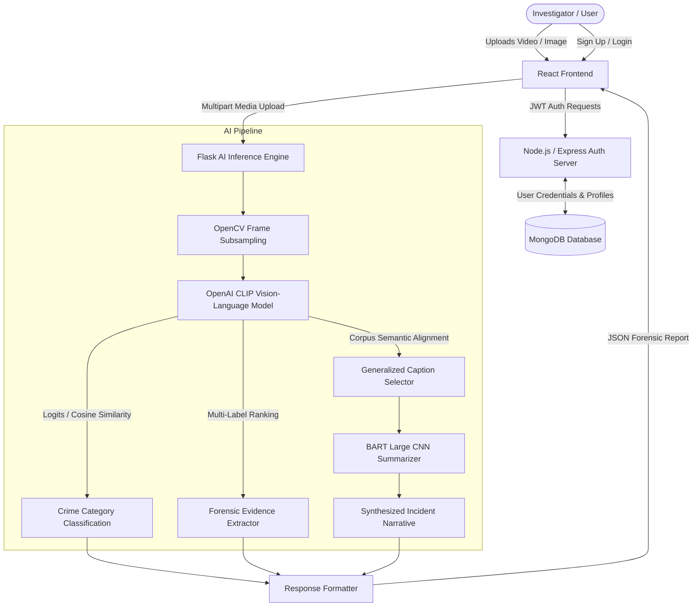

# SceneSolver: Automated Crime Video Analysis and Forensic Intelligence Platform

SceneSolver is an end-to-end multi-modal artificial intelligence system designed for automated surveillance footage analysis, forensic evidence tagging, and incident narrative synthesis. By orchestrating zero-shot vision-language models with transformer-based sequence-to-sequence summarization, SceneSolver ingests raw CCTV video or imagery, detects violent anomalies, extracts forensic cues, and compiles contextual incident reports for investigative workflows.

---

## Architecture Overview

SceneSolver decouples user identity management from compute-intensive computer vision and natural language processing tasks. The system comprises three primary tiers:

1. **Client Interface (React / Tailwind CSS)**: Provides an interactive dashboard for media upload, frame-by-frame visual verification, authentication, and forensic report review.
2. **AI Inference Engine (Flask / PyTorch / Hugging Face Transformers)**: Executes computer vision processing, OpenCV frame subsampling, CLIP zero-shot classification, forensic vocabulary extraction, and BART abstractive summarization.
3. **Authentication and Application Service (Node.js / Express / MongoDB)**: Manages secure user registration, credential hashing with bcrypt, session tokens via JSON Web Tokens (JWT), and request validation via Joi.



---

## Machine Learning Pipeline

### 1. Frame Subsampling and Temporal Extraction
Raw video inputs are processed using OpenCV (`cv2.VideoCapture`). The engine dynamically samples frames at a calibrated frequency (default: 1 frame per second up to 30 keyframes), discarding redundant background frames to optimize throughput while preserving temporal fidelity across critical action intervals.

### 2. Multi-Class Crime Classification
Images and extracted video keyframes are evaluated against a high-level incident taxonomy using OpenAI's `clip-vit-base-patch32` zero-shot classification head:
- Robbery
- Explosion
- Shoplifting
- Shooting
- Fight
- Normal Action

Logits across candidate text prompts are normalized through a softmax function. For video media, a majority-voting consensus algorithm aggregates frame-level predictions to identify the dominant crime classification.

### 3. Forensic Evidence Extraction
Each frame is cross-referenced against a forensic label dictionary encompassing over 150 visual descriptors across:
- **Combustion & Explosions**: Flames, Smoke, Blast Plume, Shockwave, Scorch marks, Crater, Debris.
- **Physical Altercations & Violence**: Punch, Grapple, Choke, Headlock, Tackled, Bleeding, Melee, Kick.
- **Weaponry & Armed Threat**: Handgun, Rifle, Shotgun, Knife, Shell casing, Bullet holes, Armed assailant.
- **Tactical & Behavioral Patterns**: Masked, Forced, Looting, Fleeing, Intruder, Defensive posture.

Predictions are scored and ranked per frame; the highest-frequency evidence indicators across the entire temporal sequence are compiled into the top 10 forensic findings.

### 4. Corpus-Aligned Caption Matching
The system loads a curated repository of forensic narrative descriptions (`generalized_captions_generalized.txt`). Keyframes are matched to the most semantically aligned caption via cross-modal cosine similarity over CLIP image-text embeddings.

### 5. Abstractive Incident Report Generation
Aggregated unique captions are passed to Facebook's `bart-large-cnn` abstractive sequence-to-sequence model. The summarizer parses temporal cues, action descriptions, and contextual observations, outputting a structured, human-readable forensic summary detailing the sequence of events.

---

## Technology Stack

### Artificial Intelligence and Machine Learning
- **PyTorch**: Deep learning backend and tensor computation.
- **Hugging Face Transformers**: Pretrained model execution for `openai/clip-vit-base-patch32` and `facebook/bart-large-cnn`.
- **OpenCV (cv2)**: Video stream decoding, frame rate parsing, and image transformations.
- **PIL (Pillow)**: Image loading and preprocessing pipelines.

### AI Inference Microservice
- **Python 3.10+**: Runtime environment.
- **Flask**: HTTP microservice exposing REST inference endpoints.
- **Flask-CORS**: Cross-Origin Resource Sharing middleware enabling secure client-server communication.

### Authentication Backend
- **Node.js & Express.js**: Asynchronous REST API framework.
- **MongoDB & Mongoose**: Document storage for user authentication data.
- **JSON Web Token (jsonwebtoken)**: Stateless Bearer token generation and authorization verification.
- **bcryptjs**: Cryptographic salted password hashing.
- **Joi**: Strict schema validation for incoming request bodies.

### User Interface
- **React 18**: Component-based single-page application (SPA).
- **React Router DOM**: Client-side declarative routing (`/login`, `/signup`, `/dashboard`, `/tool`).
- **Tailwind CSS**: Utility-first CSS framework for responsive layout styling.
- **Axios**: Asynchronous HTTP client for multipart form and JSON payloads.
- **Lucide React**: Vector iconography for interface controls.

---

## Repository Structure

```text
CrimeSceneSolver/
|-- backend/
|   |-- Controller/
|   |   `-- AuthController.js        # User signup and login handlers
|   |-- Middlewares/
|   |   |-- Auth.js                  # JWT verification middleware
|   |   `-- AuthValidation.js        # Joi schema definitions for payloads
|   |-- Models_db/
|   |   |-- User.js                  # Mongoose User schema definition
|   |   `-- db.js                    # MongoDB connection lifecycle management
|   |-- Routes/
|   |   |-- AuthRouter.js            # Auth routing (/auth/signup, /auth/login)
|   |   `-- ProductRouter.js         # Protected resource demonstration route
|   |-- uploads/                     # Temporary media upload spool directory
|   |-- app.py                       # Flask AI inference application server
|   |-- index.js                     # Node.js authentication application server
|   `-- pipeline.py                  # PyTorch/CLIP/BART video and image analysis logic
|-- frontend/
|   |-- public/                      # Static assets and HTML entry point
|   |-- src/
|   |   |-- components/              # UI components (Navbar, Footer, Features, Team)
|   |   |-- pages/                   # Application views
|   |   |   |-- Dashboard.jsx        # User overview and quick actions
|   |   |   |-- Login.jsx            # Account authentication form
|   |   |   |-- SignUp.jsx           # User registration form
|   |   |   `-- ToolPage.jsx         # Video upload and forensic report view
|   |   |-- App.js                   # Application route hierarchy
|   |   |-- index.js                 # React root DOM hydration
|   |   `-- utils.js                 # Shared front-end utility helpers
|   `-- tailwind.config.js           # Tailwind theme configuration
|-- generalized_captions_generalized.txt # Curated semantic caption corpus
|-- train_model.ipynb                # CLIP fine-tuning and evaluation notebook
|-- .gitignore                       # Git exclusion rules
`-- README.md                        # Project documentation
```

---

## API Specifications

### 1. AI Inference Microservice (Flask, Port `5000`)

#### Analyze Media File
```http
POST /analyze
Content-Type: multipart/form-data
```

**Parameters:**
- `media`: The video (`.mp4`, `.avi`, `.mov`) or image (`.jpg`, `.png`, `.jpeg`) binary payload.

**Response (`200 OK`):**
```json
{
  "crime": "robbery",
  "evidence": [
    "Handgun",
    "Cash register",
    "Masked",
    "Covering face",
    "Threatening"
  ],
  "final_summary": "Surveillance footage confirms a forced armed intrusion where a masked suspect approached the counter brandishing a handgun. Demands were made for cash assets before the subject fled the scene."
}
```

**Error Response (`400 / 500`):**
```json
{
  "error": "No media uploaded"
}
```

---

### 2. Authentication API (Node.js / Express, Port `8080`)

#### User Registration
```http
POST /auth/signup
Content-Type: application/json
```
```json
{
  "name": "Investigator Name",
  "email": "investigator@agency.gov",
  "password": "StrongPassword123"
}
```

#### User Login
```http
POST /auth/login
Content-Type: application/json
```
```json
{
  "email": "investigator@agency.gov",
  "password": "StrongPassword123"
}
```
**Response (`200 OK`):**
```json
{
  "message": "Login Success",
  "success": true,
  "jwtToken": "<JSON_WEB_TOKEN>",
  "name": "Investigator Name"
}
```

---

## Installation and Setup

### Prerequisites
- Python 3.10 or higher
- Node.js 18.x or higher and npm
- MongoDB running locally or accessible via MongoDB Atlas URI
- CUDA-compatible GPU (recommended for real-time inference; CPU supported as fallback)

---

### 1. Flask AI Inference Engine Setup

1. Navigate to the backend directory:
   ```bash
   cd CrimeSceneSolver/backend
   ```
2. Create and activate a Python virtual environment:
   ```bash
   python3 -m venv venv
   source venv/bin/activate  # On Windows: venv\Scripts\activate
   ```
3. Install required Python packages:
   ```bash
   pip install flask flask-cors torch torchvision transformers opencv-python pillow tqdm
   ```
4. Verify configuration paths:
   In `backend/pipeline.py`, ensure the caption corpus path points to your local repository directory:
   ```python
   # Default expectation: root project folder
   corpus_path = os.path.abspath("../generalized_captions_generalized.txt")
   ```
5. Launch the Flask inference server:
   ```bash
   python app.py
   ```
   The service will listen on `http://localhost:5000`.

---

### 2. Node.js Authentication Service Setup

1. Open a new terminal session in `CrimeSceneSolver/backend`:
   ```bash
   cd CrimeSceneSolver/backend
   ```
2. Install npm dependencies:
   ```bash
   npm install
   ```
3. Create a `.env` file in `backend/`:
   ```env
   PORT=8080
   MONGO_CONN=mongodb://localhost:27017/scenesolver
   JWT_SECRET=your_secure_jwt_secret_key_here
   ```
4. Start the Node.js server:
   ```bash
   npm start
   # Or for development with auto-reload:
   npx nodemon index.js
   ```
   The service will listen on `http://localhost:8080`.

---

### 3. React Frontend Setup

1. Navigate to the frontend directory:
   ```bash
   cd CrimeSceneSolver/frontend
   ```
2. Install node dependencies:
   ```bash
   npm install
   ```
3. Start the Vite/Create-React-App development server:
   ```bash
   npm start
   ```
4. Access the user interface at `http://localhost:3000`.

---

## Model Training and Customization

For training details, refer to `train_model.ipynb`. The notebook outlines:
1. Building vision-text pairs using crime-specific surveillance datasets.
2. Generating normalized embeddings with `CLIPProcessor`.
3. Loss function computation using symmetric cross-entropy over vision and text projections.
4. Exporting fine-tuned weights (`best_model.pth`) for downstream deployment into `pipeline.py`.

---

## Security Considerations

- **File Upload Limits**: Ensure reverse proxies (such as Nginx) enforce maximum client body limits to prevent resource exhaustion from large uncompressed media streams.
- **Sanitized Filenames**: Media files are processed within dedicated spool directories; paths should be sanitized to avoid directory traversal.
- **Token Invalidation**: Authentication tokens must be transmitted securely over HTTPS in production deployments.
